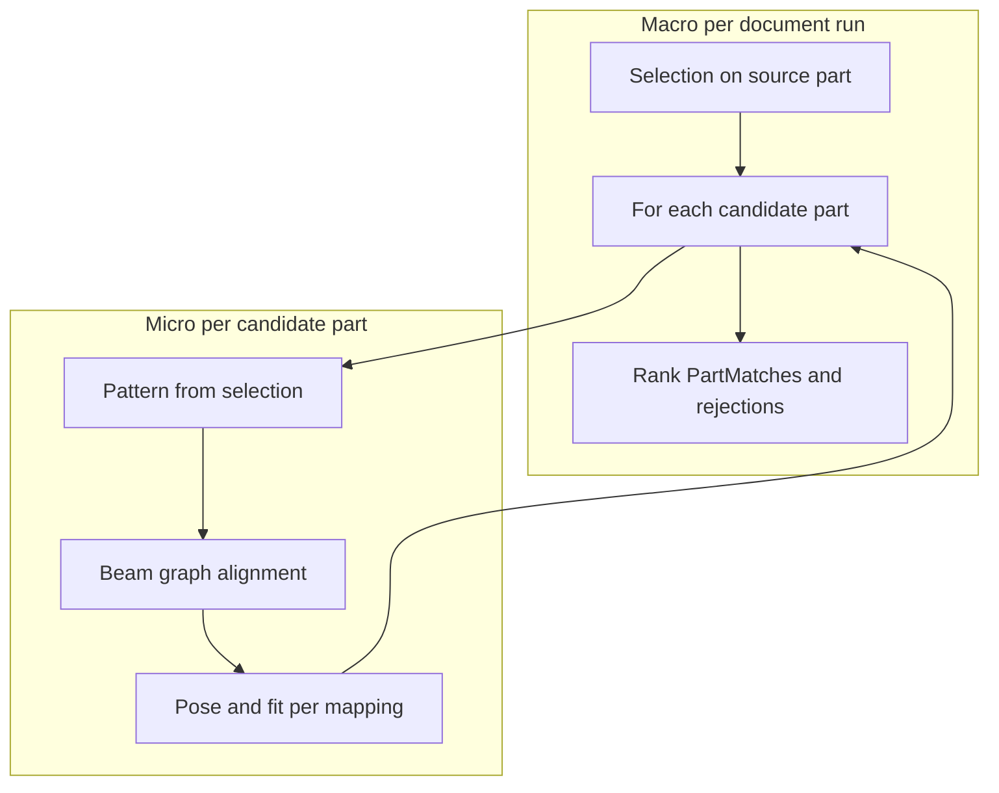

# Auto-Mating

## Intent

Auto-Mate answers one question for a CAD assembly:

> **Which other part does this part mate with, and how?**

The user picks faces on one part; the system searches the rest of the assembly and returns a ranked list of *parts*, each with the placement(s) that justify the match. Faces are evidence. Output is organized by **part**.

See also: [OVERVIEW.md](OVERVIEW.md).

## Design intent

**What we are not doing**

- Cataloging every analytic surface on every part (all cylinders, all planes, feature clusters) and matching by **global feature type**.
- Treating hard surface classification as the primary key to a mate.

**What we are doing**

- Building a **local graph pattern** from the user’s selection (topology + local attributes on nodes).
- Searching with **heuristic, scored alignment** (beam search over candidate parts), then **pose + fit** as the check that one rigid placement works for **all** selected faces together.
- Ranking multiple hypotheses; recording **why** a part failed (no alignment, alignment without acceptable pose/fit) rather than “wrong feature class.”

**Direction**

- Graph nodes and comparators stay **generic** so richer descriptors can plug in over time.
- Plane/cylinder rules apply as **local measurements on mapped pairs** after alignment, not as the discovery step.

Historical AAG/VF2-only narrative: [LEGACY_AAG.md](LEGACY_AAG.md).

## Approaching the problem: macro and micro

| Level | Question | What happens | Artifacts |
|-------|----------|--------------|-----------|
| **Macro** | Which parts mate with my source part, ranked? | One source part from selection → each other part is a candidate → `match_part` → rank `PartMatch`, collect `RejectedPart` | `RecognitionRequest`, `MateAlgorithm.run`, `AlgorithmResult` |
| **Micro** | For one candidate, is there one rigid placement for **all** selected faces? | `PartGraph` → pattern → beam alignment → pose + per-pair fit → best configuration(s) | `HeuristicMatch`, `FitResult`, metadata |

**Macro**

- Success unit is a **part** (`PartMatch`), not a lone face pair.
- One transform per configuration must explain the **whole** selection.
- Candidate parts are searched subject to filters; failures are **part-grain** with `run.explain` reasons.

**Micro**

- Pattern comes from **your** faces and adjacency, not a whole-part feature inventory.
- Alignment is **beam search**: many partial maps, scored and pruned.
- **Pose + fit** verifies geometry; gap/clearance/interference measured here.
- Several configurations per part allowed; part score rolls up from the best.



## Real-world model

| Concept | Meaning |
|---|---|
| **Part** | One solid in the document (`PartContext`). |
| **Source part** | Part that owns the selected faces. Selection never spans parts. |
| **Selection** | Faces on the source part (evidence). Need not be adjacent. |
| **Candidate part** | Any other part in the document. |
| **Mate configuration** (`Match`) | One placement vs a candidate: faces used, transform, per-pair fit, DOF, score. |
| **Part match** (`PartMatch`) | Candidate part with configurations (best first) and part score. |
| **Rejected part** | Candidate with no accepted configuration and a reason. |

Parts are **pose-free** in the document: the algorithm computes transform `T` on the source that would mate with the candidate; the model is not moved.

## Part-oriented pipeline (macro)

The base class owns the part loop:

```text
request (context + selected faces)
  -> validate; resolve MateQuery (source part)
  -> prepare               pattern / source graph (algorithm-specific)
  -> candidate_parts       default: every part except the source
  -> for each candidate part:
       match_part          -> configurations
       match postprocessors
       rank + max_matches_per_part
       score_part
       (no configurations -> RejectedPart with reason from run.explain)
  -> part postprocessors
  -> rank parts
  -> max_parts / max_results
  -> AlgorithmResult(part_matches, rejected_parts, diagnostics, timings)
```

Any algorithm gets per-part ranking, caps, cancellation/time budget, and rejection reporting.

## Default searcher: heuristic

Workbench default: **`heuristic`**. Session dials: [OVERVIEW.md](OVERVIEW.md), [HEURISTIC_MATE_ALGORITHM.md](HEURISTIC_MATE_ALGORITHM.md).

### Inside `match_part` (heuristic)

1. Load **PartGraph** for source and candidate (cached per document).
2. **Extract / enrich** pattern from selected faces (`extract_pattern_from_refs`, enricher).
3. Optional **metadata filter** on candidates.
4. **`run_search`** — beam alignment (`MatingAlignmentSearchPolicy`).
5. For each top alignment: **pose + fit** (`evaluate_pose_and_fit`); build `HeuristicMatch` with pairs, fits, metadata (e.g. `graph_alignment_score`, `mate_configuration_kind`).
6. If no configuration accepted: `run.explain(part_id, "graph aligned but no pose satisfied fit tolerance")` or earlier messages (no alignment, empty graph, etc.).

Alternative legacy path (AAG/VF2, rules): [LEGACY_AAG.md](LEGACY_AAG.md).

## Pose and fit check

After a candidate **mapping** exists, plane and cylinder pairs are measured under rigid transform `T`:

- **Plane**: opposing normals; signed gap along normal (clearance vs interference).
- **Cylinder**: opposing convexity, collinear axes; gap from radii.

**Fit** types (`MateFit/fits.py`) accept or reject gap within tolerance. This step **scores and filters** placements; it does not discover which parts to try.

Fewer remaining DOF generally yields a stronger mate and better score.

## Geometry index cache

Per-part **PartGraph** build from B-rep is expensive. **App_FreeCAD** keeps `DocumentGeometryCache` ([`geometry_cache.py`](../src/App_FreeCAD/geometry_cache.py), [`part_graph_build.py`](../src/App_FreeCAD/part_graph_build.py)) keyed by `document.Name`:

- **Lazy** build on first use; **reuse** on later runs in the same document.
- **No** automatic invalidation on geometry edit — if the model changes without a new cache, results may be **stale** until restart or cache discard.

## Output, reporting, and reasoning

| Output | Content |
|--------|---------|
| `part_matches` | Ranked parts and configurations |
| `rejected_parts` | Part-level `run.explain` reasons |
| Mating report | Pairings + `reason:` per pair ([`mate_report.py`](../src/MateCore/mate_report.py)); full rejection list |
| Display | Rank lines; report block (default); one-line rejection summary |

**Macro** rejections: why this **part** did not mate. **Micro** reasons on successes: per-pair lines in the report (graph correspondence, alignment score, fit class/gap, configuration kind). Deep algorithm trace: [TRACE.md](TRACE.md).

## Extension points

- Subclass `MateAlgorithm`, implement `match_part`.
- Postprocessors, rankers, `candidate_parts`, `FitRegistry`, `AlgorithmRegistry`.

## Current limits

- Graph builder still **emphasizes** analytic planes and cylinders; broader freeform support is a goal, not “cylinder finder” identity.
- Limited geometric verification (contact area, global interference) — hooks exist for postprocessors.
- Part = solid; sub-assembly grouping not modeled.
- Report + highlight only; no automatic constraint creation.
