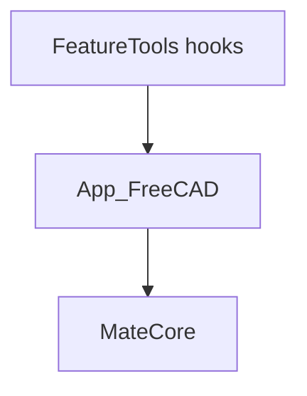

# Auto-Mate Python architecture

How the codebase is **modularized** and kept **independent of FreeCAD** in the domain layer. Product overview: [OVERVIEW.md](OVERVIEW.md). Mating domain: [Auto-Mating.md](Auto-Mating.md).

## Design goals

- **Host-independent core** — Mating logic, graphs, fits, algorithms, reports, and trace live in `src/MateCore/`. No `import FreeCAD` or `FreeCADGui` under MateCore.
- **Thin host adapter** — `src/App_FreeCAD/` maps documents and shapes to MateCore contracts and renders results.
- **Packaging shell** — `FeatureTools/` holds only workbench entry hooks (`Init.py`, `InitGui.py`). Logic is **not** maintained there; [`updateProduction.py`](../updateProduction.py) copies `MateCore` and `App_FreeCAD` from `src/` into the installed Mod package.
- **Testability** — `python -m pytest -q` at repo root runs MateCore without a GUI. Smoke-test the command in FreeCAD after deploy.

## Three layers

| Layer | Path | Role |
|-------|------|------|
| Workbench hooks | `FeatureTools/` | Module load, menu/command registration |
| Host adapter | `src/App_FreeCAD/` | Context, graph build, cache, command, display, factory, settings |
| Domain library | `src/MateCore/` | Algorithms, MateGraph, MateFit, report, trace, render *plan* |



Dependency rule: **App_FreeCAD → MateCore** only. Never MateCore → FreeCAD.

## Boundary contracts

| Module | Responsibility |
|--------|----------------|
| [`context.py`](../src/MateCore/context.py) | `SurfaceRef`, `PartContext`, `DocumentContext`, `RecognitionRequest` — stable handles; no host shapes in MateCore |
| [`algorithm.py`](../src/MateCore/algorithm.py) | `MateAlgorithm.run` template (part loop, caps, `run.explain` → `rejected_parts`); subclasses implement `match_part` |
| Graph injection | Factory passes `graph_for(part)` from [`geometry_cache.py`](../src/App_FreeCAD/geometry_cache.py) + [`part_graph_build.py`](../src/App_FreeCAD/part_graph_build.py) |
| Outputs | `AlgorithmResult`, [`mate_report.py`](../src/MateCore/mate_report.py), [`trace.py`](../src/MateCore/trace.py) — consumed by display, not defined in FreeCAD |

## MateCore modularization

| Package / module | Role |
|------------------|------|
| `MateGraph/` | `PartGraph`, merge, beam search |
| `MateAlgo_Heuristic/` | Default `heuristic` algorithm |
| `MateFit/` | Descriptors, pose, fits, configuration kind |
| `mate_match.py` | `MateMatch` DTO (pairs, fits, pose metadata) |
| `mate_report.py` | Mating report builder |
| `trace.py` | Module-scoped trace protocol |
| `postprocessors.py` | Shared rankers/filters |

Algorithms import MateGraph + MateFit + context; MateGraph does not import algorithms or FreeCAD.

## App_FreeCAD: where FreeCAD is allowed

| Module | Role |
|--------|------|
| `document_context.py` | Active document → `DocumentContext` |
| `part_graph_build.py` | **Only** B-rep → `PartGraph` conversion |
| `geometry_cache.py` | Per-document graph + metadata stores |
| `command.py` | Selection gate, phases, `algorithm.run` |
| `display.py` | Console report, rejection summary, overlays |
| `rendering/` | Apply MateCore render plan in the view |
| `algorithm_factory.py` | Registry + inject cache into `heuristic` |
| `settings.py` | Session algorithm and heuristic/trace dials |

**Anti-patterns:** match logic in `FeatureTools/`; `FreeCADGui` in MateCore; building graphs inside algorithm packages instead of the adapter.

## Repository layout

```text
Auto-mate/
├── src/
│   ├── MateCore/
│   │   ├── algorithm.py, context.py, trace.py, mate_report.py
│   │   ├── MateFit/, MateGraph/, MateAlgo_Heuristic/
│   │   └── rendering/          # style + plan (no FreeCAD)
│   └── App_FreeCAD/
│       ├── command.py, display.py, algorithm_factory.py
│       ├── part_graph_build.py, geometry_cache.py
│       └── rendering/          # FreeCAD overlay renderer
├── FeatureTools/               # Init hooks only
├── Architecture/
├── tests/
└── updateProduction.py
```

## Runtime flow

```text
IDLE -> SELECTION -> COMPUTE -> DISPLAY
```

1. **SELECTION** — snapshot context; user picks faces on one part.
2. **COMPUTE** — `sync_trace_from_preferences()`; trace sink on console; `algorithm_factory` builds `heuristic` with cache; `algorithm.run(request)`.
3. **DISPLAY** — `display_part_results`: mating report (`MODULE_REPORT`, default on), rank lines, rejection one-liner, overlays.

## Heuristic dials (session)

From [`settings.py`](../src/App_FreeCAD/settings.py), wired via `get_heuristic_mate_config()` into the factory:

- `set_algorithm("heuristic")`
- `set_heuristic_pose_validation` / `set_heuristic_fit_validation` (`strict` | `warn` | `skip`)
- `set_heuristic_skip_pose_fit`, `set_heuristic_nominal_fit_gap_mm`, `set_heuristic_disallow_single_surface_mates`
- Trace: `set_trace_global`, `set_trace_default`, `set_trace_module("report"|"heuristic"|"mategraph", level)`

Detail: [HEURISTIC_MATE_ALGORITHM.md](HEURISTIC_MATE_ALGORITHM.md), [TWEAKABLE_PARAMETERS.md](TWEAKABLE_PARAMETERS.md).

## Factory algorithms

| Factory id | Purpose |
|------------|---------|
| `heuristic` | Production mate search (default) |
| `debug_mate_graph` | Graph build/cache stress test |
| `dummy` | Workflow placeholder |
| `rendering_demo` | Overlay/render smoke test |

Run caps from factory: `AlgorithmConfig(max_parts=10, max_matches_per_part=5)` unless overridden in code.

## Testing and deployment

```powershell
python -m pytest -q
python .\updateProduction.py --dry-run
python .\updateProduction.py
```

Verify staged hashes under `Mod\FeatureTools` after deploy; smoke-test the workbench in FreeCAD GUI.
