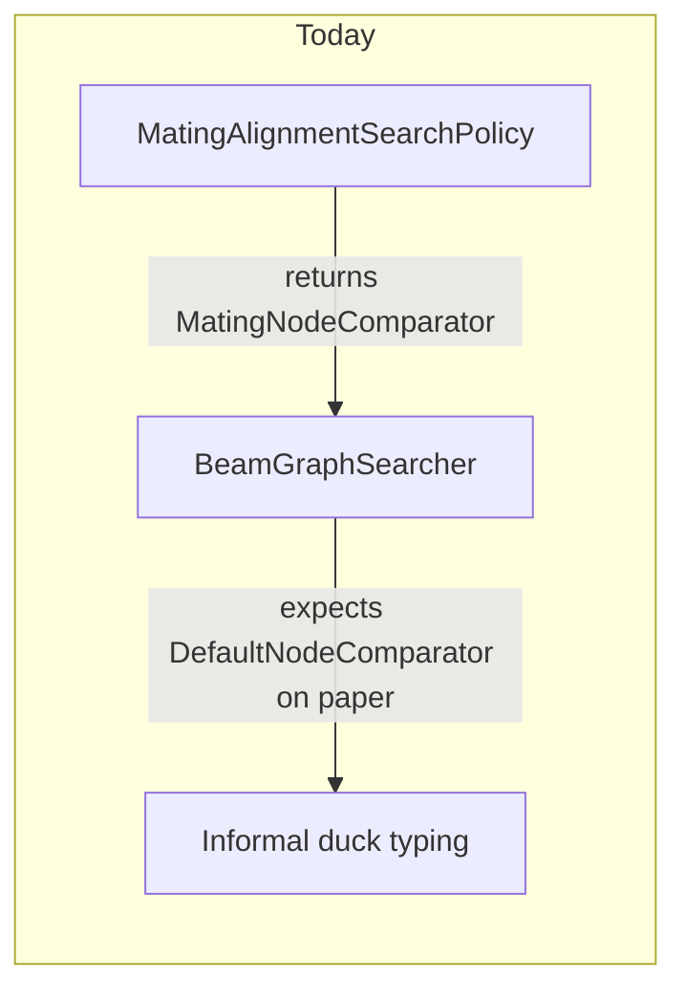
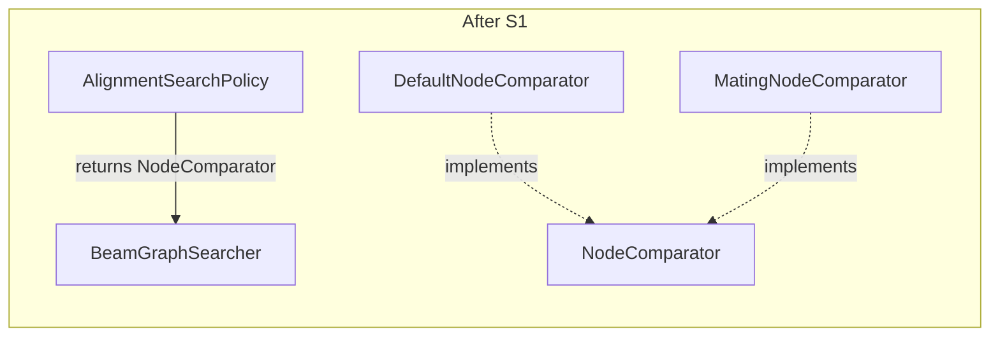
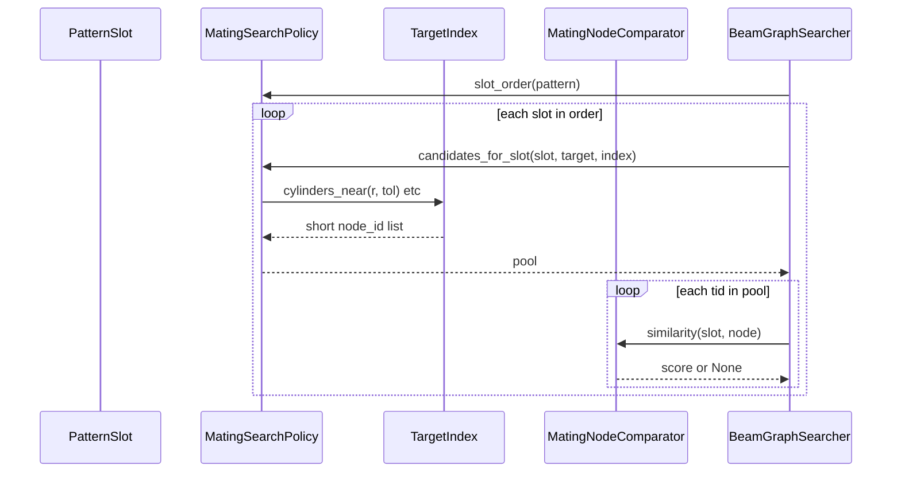

# MateGraph improvement roadmap

Living notes for how we can grow **MateGraph** so mating algorithms (especially `MateAlgo_Heuristic`, factory id `heuristic`) stay fast, correct, and easy to extend.

- **Infrastructure overview:** [`Architecture/MATEGRAPH.md`](../../Architecture/MATEGRAPH.md)
- **Heuristic mate:** [`Architecture/HEURISTIC_MATE_ALGORITHM.md`](../../Architecture/HEURISTIC_MATE_ALGORITHM.md)
- **Consolidated spec:** [`Architecture/GRAPH_MATE_CONSOLIDATED.md`](../../Architecture/GRAPH_MATE_CONSOLIDATED.md)

This file is the archived roadmap (pattern, metadata, search, build). **Tier 1** below is the current focus, explained in plain language.

---

## How graph mating uses MateGraph today (30-second picture)

You select faces on a **source part**. We build a small **pattern** (a subgraph). For each **other part**, we try to line up faces on that part with the pattern—like matching a small puzzle piece—then check whether they actually **mate** (opposite normals, shaft in hole, tolerances).

MateGraph owns the **puzzle piece** and the **search for where it might fit**. It does **not** compute final placement or assembly constraints; that stays in the mating algorithm (`MateFit`, pose solver).

```text
  Your selection  -->  GraphPattern  -->  beam search on each candidate PartGraph
                                              |
                                              v
                                    candidate face pairings (alignment)
                                              |
                                              v
                         mating algorithm: pose + fit + score (outside MateGraph)
```

---

## Tier 1 — three improvements (current focus)

These three work together: **better typing**, **smarter shortlists of faces**, and **faster lookup** on the candidate part.

| Id | Short name | One-line benefit |
|----|------------|------------------|
| **S1** | Comparator protocols | Mating rules plug in cleanly without awkward type hacks |
| **S2** | Slot candidate pool hook | Search only considers faces that can still mate under fit rules |
| **S3** | Richer target index | Find “similar” cylinders/planes without scanning every face |

---

### S1 — Comparator protocols (why typing matters)

**What happens today**

When the beam searcher tries to map pattern slot `p0` to a face on the candidate part, it asks a **node comparator**:

> “How well does this pattern slot match this graph node?”

MateGraph ships a **default** comparator: same surface kind, similar axis, similar radius and area. That is **symmetric**—it does not know “shaft vs hole.”

The **graph mating algorithm** wraps that with `MatingNodeComparator`: it also calls `FitResolver.kinds_compatible` (complementary convexity, radius bands for clearance fits, etc.).

**The awkward bit**

The policy protocol says `node_comparator()` returns `DefaultNodeComparator`. Our mating comparator is a **different class** with the same method name (`similarity`). It works in Python, but MateGraph does not officially say “any comparator with this shape is fine.” That makes the contract fuzzy for future algorithms and tests.

**What we want**

Define small **protocols** (interfaces), e.g. `NodeComparator` and `EdgeComparator`, with one method:

```text
similarity(pattern_slot, graph_node) -> float or None
```

- A **number** = soft match quality (higher is better).
- **None** = this pairing is impossible; skip it.

`DefaultNodeComparator` and `MatingNodeComparator` both implement the protocol. `AlignmentSearchPolicy.node_comparator()` returns the protocol type, not one concrete class.

**Picture**





**What you gain**

- Mating-specific logic stays in the algorithm package, but MateGraph **documents** how to plug it in.
- Easier to add another comparator later (e.g. stricter plane opposition) without touching the searcher.
- Clearer unit tests: mock comparators for search behavior.

**What we are not changing**

MateGraph still does **not** import `MateFit`. The mating comparator is provided by the consumer.

---

### S2 — `candidates_for_slot` hook (smarter shortlists)

**What happens today**

For each pattern slot, the searcher builds a list of candidate faces on the target part:

1. Take **all** target nodes with the same `surface_kind` (e.g. all cylinders).
2. If there are none, fall back to **every** face on the part.
3. Run `similarity(slot, node)` on each.

On a part with hundreds of faces and many cylinders, step 3 does a lot of work—most pairs are rejected only after `kinds_compatible` or radius checks.

**What we want**

Let the **search policy** (or the index) answer:

> “For **this** slot, which target node ids are even worth trying?”

Example for a **5 mm shaft** slot under a **clearance** fit:

- Only target **cylinders** with radius between 5.0 and 5.1 mm (from `FitResolver.size_band`).
- Optionally only **bores** (`convex=False`), not other shafts.

The beam loop becomes:

```text
pool = policy.candidates_for_slot(slot, target, index)   # small list
for tid in pool:
    if node_cmp.similarity(slot, target.node(tid)) is None: continue
    ...
```

**Picture (candidate pool)**

```text
  Pattern slot: cylinder r=5, shaft (convex)

  Target part faces:
    [cyl r=2] [cyl r=5 bore] [cyl r=5 bore] [cyl r=20] [plane] [plane] ...

  Today:           try similarity on ALL cylinders (4+)
  After S2+S3:     try only [r=5 bore] nodes (2)
```

**Interaction with S3**

S2 is the **hook** (“ask policy for the pool”). S3 is the **data structure** that makes that query fast (buckets by radius and kind).

**Safety**

Pools must be **conservative**: never omit a node that could still pass `kinds_compatible`. When unsure, return a **wider** pool (e.g. all cylinders in a loose radius band), not an empty list.

**Optional policy flag**

- `allow_skip_slot(slot_id)` — mating may forbid skipping **anchor** slots (user-selected faces); today the searcher always has a “skip this slot” branch.

---

### S3 — Richer `TargetIndex` (radius and normal buckets)

**What happens today**

[`TargetIndex`](search/index.py) only groups node ids by **kind**:

```text
by_kind["cylinder"] -> (id1, id2, id3, ... all cylinders)
by_kind["plane"]    -> (...)
```

**What we want**

Keep kind buckets, and add—for analytic surfaces—cheap keys:

| Kind | Bucket key (example) | Use |
|------|----------------------|-----|
| cylinder | `round(radius / tol) * tol` | “All faces about 5 mm radius” |
| plane | normalized axis (sign-fixed) | “All faces with normal ≈ +Z” |

API sketch:

```text
index.cylinders_near(radius, tol) -> tuple[node_id, ...]
index.planes_with_normal(axis, angle_tol) -> tuple[node_id, ...]
```

Built once per `PartGraph` when search starts (same as today’s `TargetIndex.from_graph`).

**Why it matters**

S2’s pool logic needs fast lookups. Without buckets, every slot still scans all cylinders.

**Conservative bucketing**

Use **tolerance-widened** buckets: if a face could sit in two buckets due to rounding, index it in both or use a slightly loose step so we never drop a valid mate.

---

## How Tier 1 fits together



**Implementation order (suggested)**

1. **S1** — protocols only; behavior unchanged.
2. **S3** — extend `TargetIndex`; unit tests with synthetic graphs.
3. **S2** — add `candidates_for_slot` to policy protocol; default implementation uses S3 + kind fallback (current behavior).
4. **MateAlgo_Heuristic** — mating pool via `candidates_for_slot` + `FitResolver` size bands (done).

---

## Full backlog (other tiers, brief)

### Tier 2 — pattern and metadata (fewer false negatives)

- **P1** `GraphPattern.map_slots` — easier enrich/complement transforms.
- **P3** `extract_pattern_with_expansion` — shared 1-hop neighbor expansion.
- **P4** Slot metadata keys: `required`, `optional`, roles.
- **M3** `PatternMetadataRequirements` modes: all slots vs anchors-only vs required-only.

### Tier 3 — build and operations

- **G1** Move smooth-face merge into MateGraph (drop AAG import from pipeline).
- **T1** `DocumentGraphServices` facade (metadata + graph stores).
- **T2** Wire `GraphBuildReporter` into FreeCAD build for slow-part traces.

See earlier planning tables in git history / design chats for IDs **P2–P7, M1–M7, S4–S9, C1–C4, G2–G5, T3–T4, A1–A5**.

---

## Next step after reading Tier 1

When you are ready to **implement** Tier 1 in code, we typically:

1. Add `NodeComparator` / `EdgeComparator` protocols and adjust `AlignmentSearchPolicy` (S1).
2. Extend `TargetIndex` with radius/normal buckets (S3).
3. Add `candidates_for_slot` with a default that preserves today’s behavior (S2).
4. Teach `MatingAlignmentSearchPolicy` to narrow cylinder pools via `MateFit` (consumer).

No change to the rule: MateGraph does not compute poses or emit `Match`.
